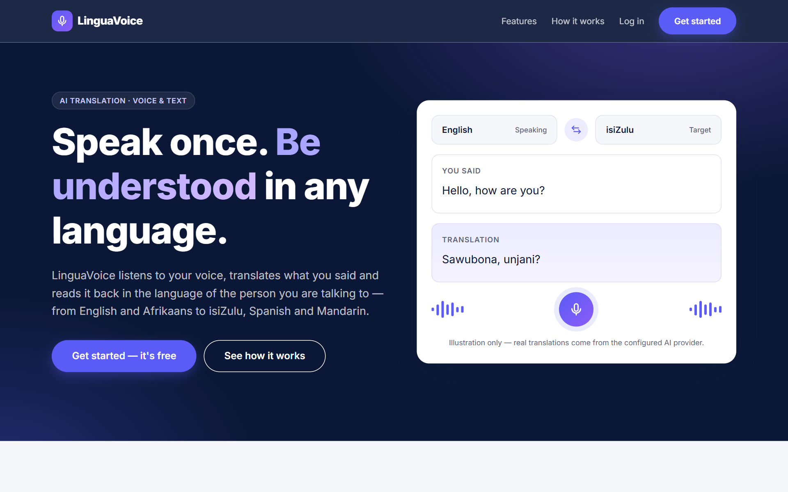
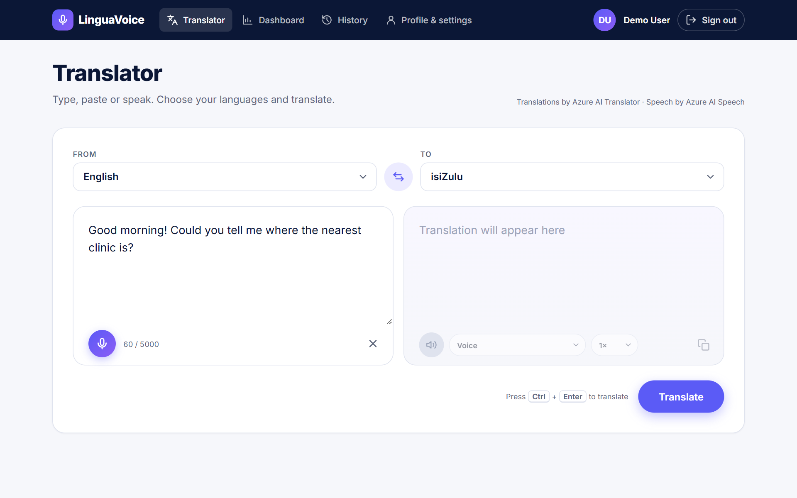
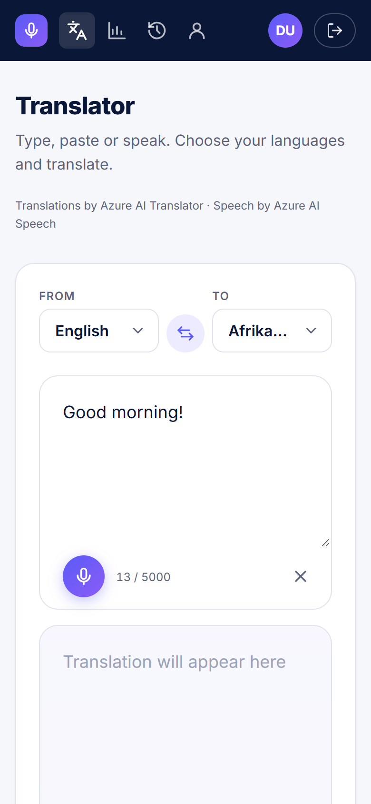
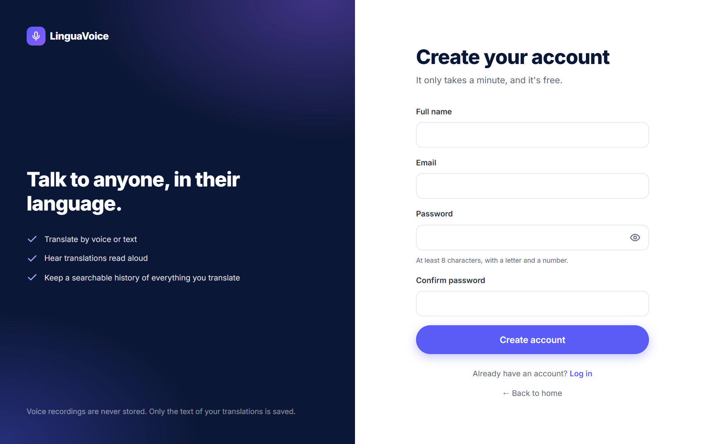
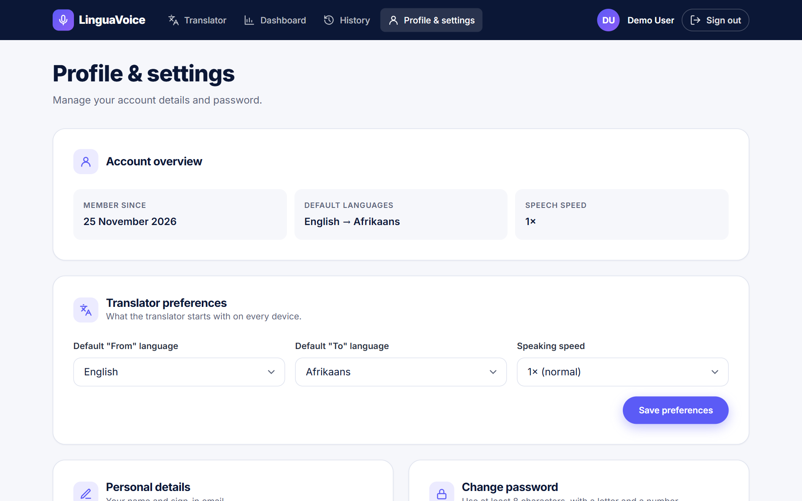

# LinguaVoice — AI Language & Voice Translator

LinguaVoice is a full-stack web application for talking across languages. You **speak or type**, it **translates**, and it **reads the translation aloud**. It supports English, Afrikaans, isiZulu, isiXhosa and eight other languages.



> **Project status:** all eight development phases are built. 166 backend and 50 frontend tests pass, and each phase was also checked in a browser against MySQL.
> Two things are still outstanding:
> - **Live AI calls are pending provider keys.** The Azure/Google integrations are tested against mock HTTP servers and a local stand-in, but have not yet run with real credentials.
> - **The Docker setup is written but has not been run yet**, because Docker wasn't available on the development machine.
>
> See [docs/CHECKLIST.md](docs/CHECKLIST.md).

## Contents
[Objectives](#objectives) · [Features](#features) · [Screenshots](#screenshots) · [Technology](#technology) · [Architecture](#architecture) · [Database](#database-design) · [Getting started](#getting-started) · [Docker](#run-with-docker) · [Configuration](#configuration) · [API](#api) · [Testing](#testing) · [Security](#security) · [Future improvements](#future-improvements)

## Objectives
- Make conversation across languages easy: speech in, translated speech out, in a few seconds.
- Treat South African languages (Afrikaans, isiZulu, isiXhosa) as first-class, and **never promise** a feature for a language the configured provider can't deliver.
- Be honest: without a configured provider the app says so (HTTP 503). It never shows invented translations.
- Show professional engineering: a layered architecture, security by default, real migrations, tests at every level and clear documentation.

## Features
| | |
|---|---|
| **Accounts** | Register, sign in and out, edit your profile, change your password (which signs out every other session). BCrypt password hashes, JWT sessions, lockout after repeated failed logins |
| **Text translation** | 12 languages, auto-detection, swap, a 5000-character limit with a counter, copy, Ctrl+Enter |
| **Voice translation** | Record in the browser (permission handling, timer, level meter, 60 s limit). The server recognises the speech and translates it. **Recordings are never stored.** For languages the server can't recognise, the browser's own speech recognition is a labelled fallback |
| **Text-to-speech** | Translations read aloud by server voices, with play, pause/resume and stop, a voice picker and a speed control (0.5×–2×). The browser's voices are the fallback |
| **History** | Every translation is saved. Search with highlighted matches, filter by language and by text/voice, delete one, or clear everything (with confirmation) |
| **Dashboard** | Totals, voice/text split, the last 7 days, a 14-day activity chart (in your time zone), most-used languages, recent activity |
| **Preferences** | Default languages and speaking speed, applied on every device |
| **Responsive and accessible** | Works from 375 px phones up; keyboard-reachable controls, ARIA labels, charts with a table view |

## Screenshots
| Translator | Phone |
|---|---|
|  |  |

| Registration | Profile and preferences |
|---|---|
|  |  |

*Dashboard and history screenshots will be added once the app runs with real provider keys. Development data contains only test-stand-in output, which would misrepresent the app. Regenerate all screenshots with [`scripts/capture-screenshots.mjs`](scripts/capture-screenshots.mjs).*

## Technology
| Layer | Technology |
|---|---|
| Frontend | HTML5, CSS3, vanilla JavaScript (ES modules), Fetch API, MediaRecorder and Web Audio API, Web Speech API (fallback). No framework, no build step |
| Backend | Java 21, Spring Boot 3.5 (Web, Data JPA, Security with JWT resource server, Validation), Hibernate, Maven |
| Database | MySQL 8, Flyway migrations |
| AI services | Pluggable providers, each Azure or Google: translation (Azure AI Translator / Google Cloud Translation), speech-to-text (Azure AI Speech / Google Speech-to-Text), text-to-speech (Azure AI Speech / Google Text-to-Speech) |
| Testing | JUnit 5, Mockito, MockMvc, MockRestServiceServer, H2; Node's built-in test runner for the frontend |
| Deployment | Docker (multi-stage backend image, Nginx frontend), Docker Compose |

## Architecture
```
Browser (HTML/CSS/JS) ──HTTPS──▶ Nginx / dev server ──/api──▶ Spring Boot API ──JDBC──▶ MySQL
   MediaRecorder → WAV                same origin               │
   <audio> playback                                             ├──▶ Translation provider
                                                                ├──▶ Speech-to-text provider
                                                                └──▶ Text-to-speech provider
```
- **The browser never calls an AI service or sees an API key.** All AI calls go through the backend.
- **Layered backend:** controllers stay thin, business rules live in services, and DTOs are returned, never entities.
- **Swappable providers:** each AI capability sits behind an interface (`TranslationProvider`, `SpeechToTextProvider`, `TextToSpeechProvider`) and is chosen from configuration.
- **Honest language support:** each language is offered per feature only if the provider supports it.

Details, request flows, design decisions and risks: [docs/ARCHITECTURE.md](docs/ARCHITECTURE.md).

```
├── backend/                 Spring Boot API (Maven)
│   └── src/main/java/com/linguavoice/
│       ├── config/  controller/  dto/  entity/  exception/  repository/  security/  service/
│       └── integration/  translation/  speech/  tts/      ← provider interfaces and adapters
├── frontend/                Static site: *.html, css/, js/{api,auth,components,pages}/, tests/
├── docs/                    ARCHITECTURE, API, TESTING, CHECKLIST, sql/, screenshots/
├── scripts/                 capture-screenshots.mjs
├── docker-compose.yml  .env.example
```

## Database design
| Table | Columns | Notes |
|---|---|---|
| `users` | id, full_name, email, password (BCrypt), created_at, updated_at, password_changed_at | email unique (stored in lower case); `password_changed_at` revokes older tokens |
| `translations` | id, user_id → users, original_text, translated_text, source_language, target_language, translation_type (`TEXT`/`VOICE`), created_at | indexes on (user_id, created_at), (user_id, source_language), (user_id, target_language); cascade delete |
| `user_preferences` | id, user_id → users (unique), preferred_source_language, preferred_target_language, speech_speed (0.50–2.00), created_at, updated_at | one row per user; cascade delete |

- The schema is created by Flyway (`backend/src/main/resources/db/migration`), and Hibernate only validates it.
- Times are stored as UTC.
- The database is utf8mb4, so Mandarin, Arabic and Japanese are stored correctly.

## Getting started
### Prerequisites
- JDK 21 and Maven 3.9+
- MySQL 8 (MySQL Workbench is useful)
- Node.js 20+ (serves the frontend; no npm packages)

### 1. Create the database (one time)
Open [`docs/sql/01-create-database.sql`](docs/sql/01-create-database.sql) in MySQL Workbench. Replace the placeholder password and run it as root. It creates `linguavoice_db` and a least-privilege `linguavoice` user. Flyway creates the tables on first start.

### 2. Configure
```bash
cp .env.example .env
```
Set at least `DB_PASSWORD` (from step 1) and `JWT_SECRET` (32+ random characters, e.g. `openssl rand -base64 64`). Then add AI provider keys ([see below](#ai-providers)). `.env` is git-ignored.

### 3. Run
```bash
cd backend && mvn spring-boot:run
```
```bash
node frontend/dev-server.mjs
```
Open **http://localhost:5500**.
- The backend runs on 8081; `curl http://localhost:8081/api/health` should report `"database":"UP"`.
- The dev server proxies `/api` to the backend (same origin, like Nginx in production) and sends a strict Content-Security-Policy.
- The startup log lists the active AI providers, or warns for each one that is disabled.

## Run with Docker
```bash
cp .env.example .env
```
In `.env`, set `DB_PASSWORD`, `MYSQL_ROOT_PASSWORD`, `JWT_SECRET` and your provider keys. Then:
```bash
docker compose up --build
```
Open **http://localhost:8088** (`APP_PORT`).

| Service | Image | Notes |
|---|---|---|
| `mysql` | `mysql:8.4` | utf8mb4; data in the `mysql-data` volume; not published to the host |
| `backend` | built from `backend/Dockerfile` | multi-stage Maven → Java 21 JRE, non-root user, health check on `/api/health`; waits for MySQL to be healthy |
| `frontend` | built from `frontend/Dockerfile` | Nginx serves the pages and proxies `/api`; security headers; 10 MB upload limit |

> The Docker files were written and the production jar was verified to run with environment-only configuration against MySQL, but `docker compose up` itself has not been run yet (Docker wasn't installed on the development machine).

## Configuration
All configuration comes from environment variables, or from `.env` when running locally. Secrets are never committed.

| Variable | Default | Purpose |
|---|---|---|
| `DB_URL` | `jdbc:mysql://localhost:3306/linguavoice_db?…` | JDBC URL |
| `DB_USERNAME` / `DB_PASSWORD` | `linguavoice` / – | database account |
| `JWT_SECRET` | – (**required**) | token signing key, 32+ characters |
| `JWT_EXPIRATION_MINUTES` | `60` | token lifetime |
| `SERVER_PORT` | `8081` | backend port |
| `CORS_ALLOWED_ORIGINS` | `http://localhost:5500,…` | origins allowed to call the API directly |
| `TRANSLATION_PROVIDER` / `_API_KEY` / `_REGION` / `_ENDPOINT` | `none` | text translation (`azure` or `google`) |
| `STT_PROVIDER` / `_API_KEY` / `_REGION` / `_ENDPOINT` | `none` | speech-to-text |
| `TTS_PROVIDER` / `_API_KEY` / `_REGION` / `_ENDPOINT` | `none` | text-to-speech |
| `AI_RATE_LIMIT_PER_MINUTE` | `30` | AI requests per user per minute |
| `MAX_AUDIO_UPLOAD_SIZE` | `10MB` | multipart upload limit |
| `APP_PORT` / `MYSQL_ROOT_PASSWORD` | `8088` / – | Docker Compose only |

### AI providers
| Capability | Azure | Google | Language notes |
|---|---|---|---|
| Translation | **Translator** resource: `TRANSLATION_PROVIDER=azure`, key and region | **Cloud Translation API**: `TRANSLATION_PROVIDER=google`, API key | languages are read from the provider's live list |
| Speech-to-text | **Speech** resource: `STT_PROVIDER=azure`, key and `STT_REGION` | **Speech-to-Text API**: `STT_PROVIDER=google`, API key | **isiXhosa: Google only** (Azure doesn't support xh-ZA) |
| Text-to-speech | the same Speech resource: `TTS_PROVIDER=azure`, key and `TTS_REGION` | **Text-to-Speech API**: `TTS_PROVIDER=google`, API key | voices are read from the provider's live list |

One Azure "AI services" multi-service key can cover all three. Without a provider, the matching feature reports that it isn't configured, or falls back to the browser for speech input and output.

## API
REST and JSON under `/api`. Requests authenticate with `Authorization: Bearer <token>`. All errors share one JSON shape.

| Area | Endpoints |
|---|---|
| Auth | `POST /api/auth/register`, `POST /api/auth/login` |
| Account | `GET/PUT /api/users/profile`, `PUT /api/users/preferences`, `PUT /api/users/password` |
| Translation | `GET /api/languages`, `POST /api/translations/text`, `POST /api/translations/voice` (multipart WAV) |
| History | `GET /api/translations/history`, `GET/DELETE /api/translations/{id}`, `DELETE /api/translations/history` |
| Dashboard | `GET /api/dashboard/statistics`, `GET /api/dashboard/recent-activity` |
| Speech | `GET /api/speech/voices`, `POST /api/speech/synthesize` (returns `audio/mpeg`) |
| Health | `GET /api/health` |

Full reference with request and response examples, rules and status codes: **[docs/API.md](docs/API.md)**.

## Testing
```bash
cd backend && mvn test
```
```bash
cd frontend && npm test
```
**166 backend tests** cover:
- authentication, password hashing and lockout;
- token attacks (forged, unsigned, edited, revoked);
- cross-user isolation;
- validation, and a sweep of 19 malformed requests;
- translation, voice and speech endpoints;
- the exact HTTP contracts of all six provider adapters;
- history, dashboard and database constraints.

**50 frontend tests** cover form validation, API error handling, the session and open-redirect protection, microphone-permission errors, audio playback and WAV encoding.

No test needs MySQL, Docker or a paid API. See **[docs/TESTING.md](docs/TESTING.md)**.

## Security
- Passwords are hashed with BCrypt (cost 12) and never returned. The same message and timing are given for an unknown email and a wrong password.
- **Tokens:** stateless HS256 JWTs (60 min), checked for signature, algorithm, expiry and issuer. Revoked on password change or account deletion.
- **Brute-force protection:** 5 failed logins per email in 15 minutes locks that email (429).
- **Authorisation:** every query is scoped to the token's user. Other users' records return 404.
- **Validation and injection:** input is validated on the server (Bean Validation) and SQL is fully parameterised (JPA/Criteria). Uploads are checked by their bytes (WAV format, duration, 10 MB), and SSML is escaped.
- **Rate limiting:** a per-user token bucket on AI endpoints.
- **Headers:** strict CSP on the pages and the API, `nosniff`, `X-Frame-Options: DENY`, `no-referrer`, no-store caching.
- **Secrets:** environment variables only; `.env` is git-ignored. AI keys never reach the browser.
- **Privacy:** voice recordings and generated audio are processed in memory and never stored.

## Future improvements
- Live verification with Azure and Google credentials, and dashboard/history screenshots from real data.
- Continuous integration (GitHub Actions) running both test suites and building the Docker images.
- Redis-backed rate limiting and lockout for running several backend instances.
- Streaming speech recognition (WebSocket) for live, sentence-by-sentence conversation mode.
- Refresh tokens or http-only cookie sessions; email verification and password reset.
- Dark mode; offline caching of recent translations (a PWA).
- More languages (Sesotho, Setswana, Xitsonga…) as providers add support.

## Documentation
[Architecture](docs/ARCHITECTURE.md) · [API reference](docs/API.md) · [Testing](docs/TESTING.md) · [Development checklist](docs/CHECKLIST.md) · [Database setup SQL](docs/sql/01-create-database.sql)
